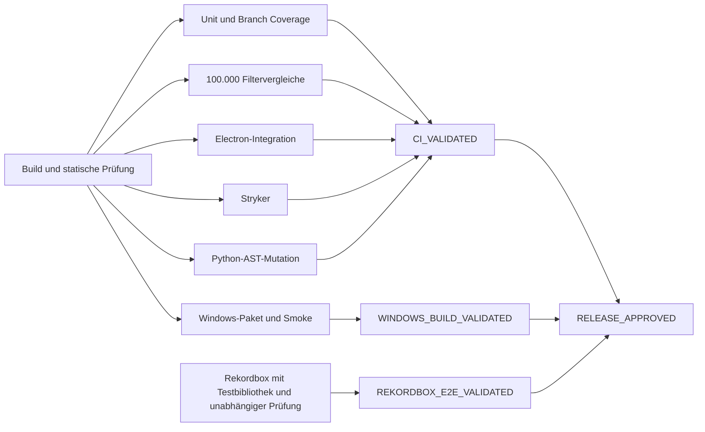

# Cuepoint-Freigabeprüfung

`quality-gate.yml` führt Build und statische Prüfungen zuerst aus. Unit- und Branch-Tests, der Filtervergleich, Electron-UI, beide Mutationsjobs und der Windows-Build laufen danach unabhängig. Der abschließende Job lädt die Nachweise desselben Workflow-Laufs und erzeugt JSON und Markdown.



Jeder Erzeuger versiegelt die festgelegten Dateien mit dem ausgecheckten Commit, der GitHub-Run-ID und SHA-256. Bei einer Wiederholung innerhalb derselben Run-ID bleiben unveränderte Artefakte erfolgreicher Jobs desselben Commits verwendbar. Ein neuer Workflow-Lauf erhält einen eigenen Geltungsbereich. Vor einer lokalen Prüfung den ausgecheckten Commit und die Herkunft der Nachweise prüfen. `CUEPOINT_GATE_RUN` gibt den gemeinsamen Geltungsbereich an. Bei heruntergeladenen CI-Nachweisen ist das `github:Airdox/iste-rekordbox:<run-id>`.

Globale Coverage-Messgrößen müssen je Stack 90 % erreichen. Die Branch-Matrix in `scripts/quality_requirements.json` benennt Anforderungen, Quellbereiche und Testfälle. Der JSON-Bericht enthält Python-Zweigkanten mit den tatsächlich gemessenen pytest-Testkontexten. Bei TypeScript und Electron enthält er die Istanbul-Branch-IDs und Armpositionen aus der jeweiligen Suite zusammen mit den ausgeführten Testfällen. Die Messung erfolgt dort pro Suite. Jeder kritische Arm braucht einen Treffer.

Die Stryker- und AST-Berichte müssen global und pro mutiertem Pflichtmodul mindestens 95 % erreichen. Stryker zählt Timeouts im offiziellen Score. Der Bericht zeigt den Assertion-Score und Timeouts gesondert. Python erfasst erfolgreiche Mutanten, Assertions, Timeouts und Prozessfehler als eigene Ausgänge. Für eine Produktionsfreigabe müssen überlebende Mutanten entweder durch einen Test geschlossen oder fachlich geprüft sein. Eine Äquivalenzentscheidung in `scripts/quality_mutation_adjudications.json` benötigt `sourceSha256`, `auditor`, `reason` und `equivalent: true`. Der Schlüssel lautet für Stryker `stryker:<file>:<line>:<column>:<mutatorName>:<replacement>` und für Python `python-ast:<id>`. Die gemessenen Scores bleiben unverändert.

## Rekordbox auf einem isolierten Windows-Desktop

Für die Desktop-Abnahme eine frische Rekordbox-Testbibliothek mit generierten oder kopierten Audiodateien in einer separaten Windows-Umgebung verwenden. Der Produktionsdatenträger bleibt außerhalb dieser Umgebung. Einen Testtrack mit bekanntem Titel, Interpret, BPM und Camelot-Key auswählen. Deck, Wiedergabestatus und Cuepoint-Erkennung vergleichen. Anschließend harmonische Auswahl, Filter, Sortierung, Setliste und Rekordbox-Übergabe gegen die erwarteten Daten prüfen. `scripts/inspect_rekordbox_uia.py` kann die sichtbaren UIA-Elemente für das Protokoll erfassen.

Screenshots, Logs und die Referenzdaten unter `reports/rekordbox-evidence/` ablegen. `reports/rekordbox-e2e.json` enthält die Felder `schemaVersion: 1`, `commit`, `platform: "Windows"`, `rekordboxVersion`, `portableSha256`, `operator`, `auditor`, `testTrack` mit `title`, `artist`, `bpm`, `key` und `deck` sowie `steps`. Die Schrittnamen stehen in `LIVE_STEPS` im Verifier. Für jeden Schritt `passed: true`, eine konkrete `observation` und unter `files` die Zuordnung von relativen Dateinamen zu SHA-256 erfassen. Operator und Auditor dokumentieren getrennt ihre Prüfung.

```powershell
python scripts/quality_gate.py seal rekordbox
python scripts/quality_gate.py verify --require RELEASE_APPROVED --portable <Pfad-zur-geprüften-portablen-EXE>
```

Der GitHub-gehostete Lauf liefert einen Windows-Kandidaten mit Paket-SHA und einem Smoke-Test des gepackten Electron-Programms sowie einem Boot-Test des portablen Wrappers. Die Produktionsfreigabe prüft zusätzlich den SHA-256 der tatsächlich vorgelegten EXE gegen den Build und die Rekordbox-Abnahme. Die vier Stufen stehen in `reports/quality-gate-report.json`.

Der separate lokale Datenbanktest lässt sich mit `CUEPOINT_VERIFY_REAL=1` und `pytest tests/test_readonly.py::test_production_snapshot_leaves_master_and_sidecars_byte_identical` ausführen. Er prüft den lesenden Zugriff anhand der Hashes und Metadaten der Datenbank und ihrer Sidecars.

### M3U8-Re-Import mit Playwright und nativen Screenshots

Auf dem isolierten Windows-Desktop zunächst Cuepoint bauen oder die gepackte `Cuepoint.exe` angeben. Der Test erstellt drei kurze WAV-Dateien mit Leerzeichen und Umlauten im Pfad. Playwright fügt die Tracks in einer absichtlich unsortierten Reihenfolge zum Set hinzu, speichert die Cuepoint-Screenshots und prüft die tatsächliche heruntergeladene M3U8.

```powershell
node tests/rekordbox-reimport.cjs reports/rekordbox-evidence
```

Das Zielverzeichnis muss neu sein. Danach in Rekordbox **Datei → Importieren → Playlist importieren** wählen und die exportierte Datei `Cuepoint-QA-*.m3u8` öffnen. Den nativen Dateidialog mit ausgewählter Datei als `03-rekordbox-import-dialog.png` sichern. Die neue Playlist in Rekordbox auswählen und die Titel in aufsteigender Playlist-Positionsnummer anzeigen. Den Playlistnamen und alle drei Zeilen zusammen als `04-rekordbox-imported-playlist.png` sichern. Die Reihenfolge in Rekordbox darf für diese Prüfung nicht umnummeriert werden.

Die importierte Playlist über ihr Kontextmenü als M3U8 in dasselbe Verzeichnis unter `rekordbox-reexport.m3u8` exportieren. Der Prüfer vergleicht beide Playlistdateien mit der vor dem Import erstellten Referenz, einschließlich Reihenfolge, Duplikaten und Änderungen an den Audiodateien. Der Auditor prüft zusätzlich die nativen Screenshots und bestätigt, dass der Rückexport aus der neu importierten Playlist stammt.

```powershell
python scripts/rekordbox_reimport.py verify reports/rekordbox-evidence
```

Den erzeugten `rekordbox-reimport-result.json` sowie alle darin referenzierten Dateien unter `rekordbox-playlist-reimport` in der Desktop-Abnahme mit ihren SHA-256-Werten erfassen. Diese M3U8-Abnahme verlangt eine interaktive Rekordbox-Session. XML ist ein eigener Importpfad über **rekordbox xml** im Media Browser. [Rekordbox-Handbuch, S. 40 und 45](https://cdn.rekordbox.com/files/20260409151936/rekordbox7.214_manual_EN.pdf)
